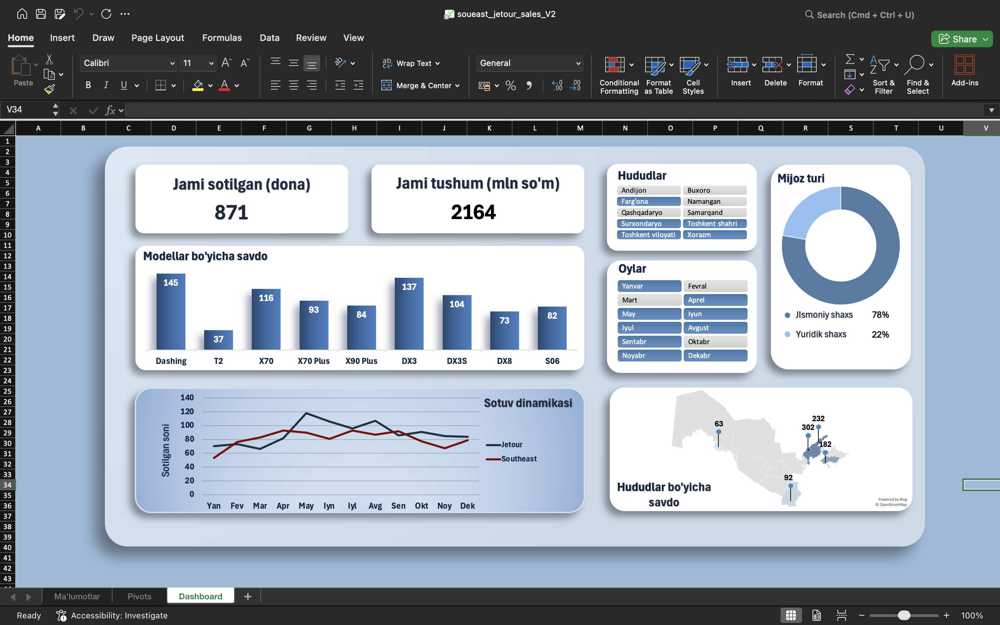

# Car Sales Dashboard (Excel)

An interactive car sales dashboard built in Excel, covering the **Jetour** and **Soueast** car brands along with detailed information about their individual models. The goal was to bring together sales trends, regional performance, and customer insights into a single, easy-to-read view.

## 📊 Features

- 📈 **Line Chart** — Shows how many cars were sold throughout the year, split into two lines comparing Jetour and Soueast sales side by side, making it easy to spot trends and seasonal patterns.
- 🗺️ **Interactive Map** — Displays the number of cars sold in each region using clean, functional pin indicators. The map updates dynamically whenever the time slicer is changed, giving a real-time view of regional performance.
- 🍩 **Donut Chart** — Illustrates the percentage breakdown of customers by type, distinguishing between Individual and Legal Entity buyers.
- 📊 **Bar Chart** — Highlights the number of car models sold within the selected region and time period, making it simple to identify top-performing models.
- 🧾 **Summary Cards** — Provide a quick, high-level overview of total units sold and net revenue at a glance.

## Dashboard Preview

